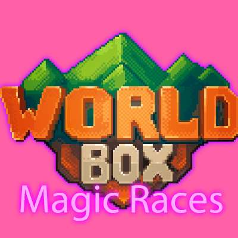

# Magic Races

> Humans, elves, orcs and dwarves cast spells and fight with their own magic staffs.

**[Download Magic Races 0.0.3](https://github.com/AgricheX/magic-races/releases/latest/download/MagicRaces.zip)**

| | |
| --- | --- |
| Game | WorldBox 0.22 / 0.23 |
| Mod loader | NCMS |
| Version | 0.0.3 |
| Author | Agriche |

English first, português do Brasil logo abaixo.

---

## English

### What it adds

- Humans cast Blood Rain, Lightning and Shield, with the White Staff.
- Elves cast Blood Rain, Grass Seeds, Fertilizer and Shield, with the Druid Staff.
- Orcs cast Blood Rain, Curse and Shield, with the Necromancer Staff.
- Dwarves cast Blood Rain, Fire and Shield, with the Evil Staff.
- Each race gets its own casting effect color and a soul.

### How to install

1. Install NCMS for WorldBox 0.22 / 0.23.
2. Download **MagicRaces.zip** with the link above.
3. Extract it into the `Mods` folder of your WorldBox installation, so you get `Mods/MagicRaces/mod.json`.
4. Start the game.

### Help

Questions and bug reports: [Agriche Community on Discord](https://discord.gg/s3EbgNSsJW).

---

## Português (Brasil)

### O que o mod adiciona

- Humanos lançam Chuva de Sangue, Raio e Escudo, com o Cajado Branco.
- Elfos lançam Chuva de Sangue, Sementes, Fertilizante e Escudo, com o Cajado Druida.
- Orcs lançam Chuva de Sangue, Maldição e Escudo, com o Cajado Necromante.
- Anões lançam Chuva de Sangue, Fogo e Escudo, com o Cajado Maligno.
- Cada raça ganha uma cor própria de efeito de magia e uma alma.

### Como instalar

1. Instale o NCMS para o WorldBox 0.22 / 0.23.
2. Baixe o **MagicRaces.zip** pelo link acima.
3. Extraia na pasta `Mods` do WorldBox, de forma que fique `Mods/MagicRaces/mod.json`.
4. Abra o jogo.

### Ajuda

Dúvidas e bugs: [Agriche Community no Discord](https://discord.gg/s3EbgNSsJW).

---

WorldBox © Maxim Karpenko. This is a free, fan-made mod, not affiliated with the WorldBox developers.
